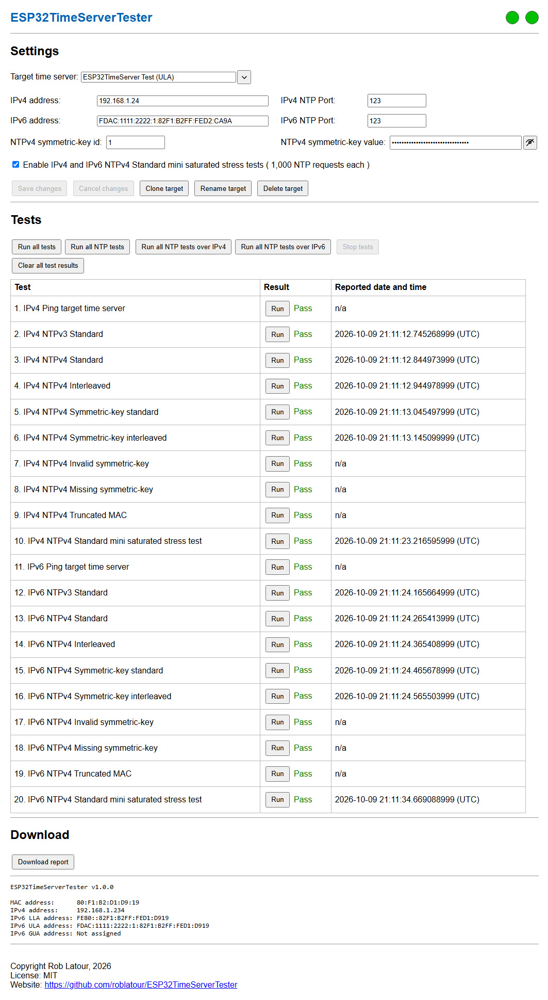

# ESP32 Time Server Tester (version 1)

An ESP32 based tester for NTP servers on your private network<br>
and an ideal companion to [ESP32TimeServer](https://github.com/roblatour/ESP32TimeServer).

[](LICENSE)

---

## Overview

This project provides a dedicated **ESP32 Time Server Tester** with a browser-based
interface for checking an NTP server over IPv4 and IPv6. It can test NTPv3 and
NTPv4 responses, interleaved mode, symmetric-key authentication, rejection of
invalid authentication, and optional mini saturated stress tests.



Save settings for multiple target servers, run individual tests or groups of
tests, and review the live results directly in your browser. The **Download report**
button exports the settings and results as Markdown; see an
[example downloaded report](./Misc/ESP32TimeServerTester_ESP32TimeServer_Test_(ULA).md).

---

## Hardware

| Qty | Item                                                                                                                       |
| --- | -------------------------------------------------------------------------------------------------------------------------- |
| 1   | WaveShare [ESP32-P4-ETH](https://www.waveshare.com/esp32-p4-eth.htm?sku=32086) or ESP32-P4-POE-ETH development board       |
| 2   | (optional) WS2812 RGB LEDs ([AliExpress](https://www.aliexpress.com/item/1005009109749689.html))                           |
| 1   |            470&Omega; resistor for the data connection to the first WS2812 (if the optional WS2812s are used)              |
| —   | Ethernet cable, hookup wires, and either a PoE-capable switch/injector (for a PoE board) or a USB-C power supply and cable |

> **WARNING — Do not power the ESP32-P4-POE-ETH from both USB-C and a PoE-powered
> Ethernet cable at the same time.** Use only one power source.

### Optional Wiring if your going to use the WS2812 RBG LEDs

#### First WS2812 RGB LED → ESP32-P4-ETH / ESP32-P4-POE-ETH

| First WS2812 pin | Connection                    | ESP32-P4 pin |
| ---------------- | ----------------------------- | ------------ |
| GND              | Direct                        | GND          |
| DI               | Through a 470&Omega; resistor | GPIO 4       |
| 5V               | Direct                        | V5 / VBUS    |

**Important:** Place the 470&Omega; resistor in series between GPIO 4 and **DI**
on the first WS2812. Do not omit it.

#### First WS2812 RGB LED → second WS2812 RGB LED

| First WS2812 pin | Second WS2812 pin |
| ---------------- | ----------------- |
| DO               | DI                |
| GND              | GND               |
| 5V               | 5V                |

The first LED shows **IPv4** status; the second shows **IPv6** status. Blue on
both means startup is in progress; red on both indicates a disconnected
Ethernet link. After startup, the IPv4 LED is green when an IPv4 address is
available and red otherwise. The IPv6 LED is blue for a global unicast address
(GUA), green for a unique local address (ULA), yellow for a link-local address
(LLA), and red when IPv6 is unavailable.

The data pin, LED enable switch, and brightness are defined in
[`main/ESP32TimeServerTesterSettings.h`](./main/ESP32TimeServerTesterSettings.h).

---

## Software

### Build and development environment

**To build and flash ESP32TimeServerTester**, install **Espressif ESP-IDF v6.1**
or later. See the [ESP-IDF installation instructions](https://docs.espressif.com/projects/esp-idf/en/stable/esp32/get-started/index.html).
Visual Studio Code with the ESP-IDF extension is recommended for development,
but is not required to build and flash the project.

### Dependencies

The ESP-IDF Component Manager resolves `espressif/mdns` and
`espressif/led_strip` at build time, as declared in
[`main/idf_component.yml`](./main/idf_component.yml).

## Setup

### Setup Step 1 - Download

Clone this repository:

```cmd
git clone https://github.com/roblatour/ESP32TimeServerTester
```
```cmd
cd ESP32TimeServerTester
```

### Setup Step 2 - Configuration

Review [`main/ESP32TimeServerTesterSettings.h`](./main/ESP32TimeServerTesterSettings.h)
for the device hostname, Ethernet pins, optional MAC override, NTP port,
WS2812 enable switch, data pin, brightness, and mini stress test request count.
The default WS2812 data pin is **GPIO 4**, and each enabled mini stress test
sends **1,000 NTP requests**.

### Setup Step 3 - Build

Open a Command Prompt in the project root and load the ESP-IDF v6.1 (or later)
environment. If ESP-IDF is installed elsewhere, adjust the path below:

```cmd
call C:\esp\v6.1\esp-idf\export.bat
```

Before building for a different board or chip revision, remove any previously
generated `.\sdkconfig` so ESP-IDF can regenerate it from the common
`.\sdkconfig.defaults` and the selected revision profile in `.\config\`:

```cmd
if exist sdkconfig del sdkconfig
```

**Check the ESP32-P4 chip revision before building.** Connect the development
board over USB and run the following command, replacing `COMx` with its serial
port (for example, `COM6`):

```cmd
esptool.py -p COMx flash-id
```

The output includes the chip type and revision number. As in ESP32TimeServer,
this project combines the common `.\sdkconfig.defaults` with one of three
revision-specific defaults files in `.\config\`. Use the command below matching
your **chip's revision**, rather than relying on the development board's name:

- For ESP32-P4 chips at **revision v3.1 and above**, including newer WaveShare
  ESP32-P4-ETH / ESP32-P4-POE-ETH boards with these chip revisions:

  ```cmd
  idf.py -D SDKCONFIG_DEFAULTS="sdkconfig.defaults;config/esp32p4_rev_v3_1.defaults" set-target esp32p4 build
  ```

- For ESP32-P4 chips at **revision v3.0**:

  ```cmd
  idf.py -D SDKCONFIG_DEFAULTS="sdkconfig.defaults;config/esp32p4_rev_v3_0.defaults" set-target esp32p4 build
  ```

- For ESP32-P4 chips **earlier than revision v3.0**, including older WaveShare
  ESP32-P4-ETH boards with engineering-sample chips such as rev v1.3:

  ```cmd
  idf.py -D SDKCONFIG_DEFAULTS="sdkconfig.defaults;config/esp32p4_rev_pre_v3.defaults" set-target esp32p4 build
  ```

The first build may download the `espressif/mdns` and `espressif/led_strip`
components through the ESP-IDF Component Manager into `.\managed_components\`.
This generated folder is not part of the repository. No manual chip-revision
selection in `menuconfig` is needed when using these profiles.

For subsequent builds with the same configuration, use `idf.py build`. If you
change chip revisions or regenerate `.\sdkconfig`, use the matching command above
again. **Do not force-flash firmware built for a different chip revision.**

### Setup Step 4 - Flash

Connect the board over USB and replace `COMx` with its serial port:

```cmd
idf.py -p COMx flash monitor
```

---

## Testing a Time Server


> <span style="color: yellow;"> **Important Note:**<br> </span>
> <span style="color: yellow;">
> This program should only be used to test internal time services that you are authorized to test.  Testing external time servers, or against public NTP pools,
> may cause your entire network to be banned. </span> 

1. Connect the tester to your network via Ethernet and power it on. Open its
   web interface using the hostname or IPv4 address printed in the console
   log. The default hostname is `ESP32TimeServerTester`. So for example, using 
   your default browser, browse to `http://esp32timeservertester` or `http://x.x.x.x`
   (where `x.x.x.x` is the ESP32TimseServerTester's IPv4 address as shown in its console log).
3. Enter a friendly **target time server** name and its IPv4 and/or IPv6 address,
   along with the applicable NTP port (default **123**). These are the *server's*
   addresses, not the tester's addresses.   
4. If the server uses NTPv4 symmetric-key authentication, enter its key ID and
   key value. Optionally enable the IPv4 and IPv6 mini saturated stress tests.
5. Save the settings, then run all tests, just the NTP tests, the IPv4 or IPv6
   group, or an individual test. Results and reported timestamps appear in the
   test table.
6. Once results are available, click **Download report** to export them as a
   Markdown file. Here is an [example report](./Misc/ESP32TimeServerTester_ESP32TimeServer_Test_(ULA).md).

The tester includes ping checks, standard NTPv3 and NTPv4 requests,
interleaved NTPv4 requests, authenticated requests, invalid/missing/truncated
authentication checks, and optional mini stress tests for each address family.
Tests that need an address or key cannot run without the corresponding settings.


---

## License

This project is released under the **MIT License** — see the [LICENSE](LICENSE)
file for details.

---

## Supporting This Project

To help support this project, or to just say thanks, you're welcome to 'buy me a
coffee'.

[](https://www.buymeacoffee.com/roblatour)

---

Copyright © 2026 Rob Latour
